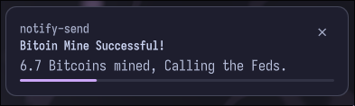
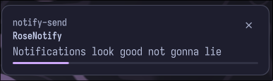

# rosenotify
A (cool) notification daemon.




## requirements

- **linux + wayland** — rosenotify is intended for wayland desktops.
- **[quickshell](https://github.com/quickshell-mirror/quickshell)** — required to run the daemon.
- **no other notification daemon** — rosenotify owns the freedesktop notification bus; make sure dunst, mako, swaync, etc. are not running.
- **libnotify** — provides `notify-send` for testing. optional but recommended.
- **coreutils** — used by the installer for file operations.

some features may require additional system utilities or services, depending on how they are implemented. make sure any tools used by your configuration are installed and available in your `PATH`.

## installation

clone the repository and run the installer:

```bash
git clone https://github.com/sappyware/rosenotify.git
cd rosenotify
chmod +x install.sh
./install.sh
```

the installer copies the QML files into `~/.config/quickshell/rosenotify/` and seeds `~/.config/rosenotify/config.toml` if it does not already exist.

## running

start rosenotify with:

```bash
qs -c rosenotify
```

to stop it, use:

```bash
qs -c rosenotify kill
```

example usage in MangoWM:
```bash
exec_once=qs -c rosenotify
```

## configuration

config file is located at `~/.config/rosenotify/config.toml`. the file is watched — changes apply live.

```toml
# rosenotify config

[general]
monitor = "primary"           # primary | all | <output name>
position = "top-right"        # top/bottom + left/center/right
margin_x = 24
margin_y = 24
spacing = 12
width = 380
max_visible = 5
newest_first = true
layer = "overlay"             # background | bottom | top | overlay
do_not_disturb = false
dnd_allow_critical = true

[timeout]                     # seconds, 0 = never expire
low = 4
normal = 8
critical = 0

[animation]
style = "slide"               # slide | fade | scale | pop | drop | bounce | none
enter_duration = 420
exit_duration = 260
reflow_duration = 300
distance = 48
easing = "OutCubic"           # Linear | InCubic | InBack | OutQuad | OutCubic | OutQuart | OutExpo | OutBack | OutElastic | OutBounce | InOutCubic

[behavior]
left_click = "invoke"         # invoke | dismiss | dismiss_all
right_click = "dismiss"
middle_click = "dismiss_all"
pause_on_hover = true
respect_app_timeout = true
show_icons = true
show_app_name = true
show_actions = true
show_close_button = true
show_progress = true
max_body_lines = 4

[theme]
active = "catppuccin_mocha"

[themes.catppuccin_mocha]
extends = "rose"              # inherit missing keys from a builtin or other theme
background = "#1e1e2e"
foreground = "#cdd6f4"
body = "#bac2de"
subtext = "#a6adc8"
border = "#45475a"
accent = "#cba6f7"
low = "#94e2d5"
normal = "#cba6f7"
critical = "#f38ba8"
button = "#313244"
button_hover = "#45475a"
progress_track = "#313244"
shadow_color = "#11111b"
shadow_opacity = 0.6
shadow_blur = 1.0
shadow_offset_y = 8
opacity = 1.0
radius = 12
border_width = 1
padding = 16
icon_size = 48
icon_radius = 10
accent_width = 4
progress_height = 3
font_family = "Iosevka NF"
font_size = 16
summary_size = 14
summary_weight = 600

[themes.dawn]                 # builtin light theme, shown standalone
background = "#faf4ed"
foreground = "#575279"
body = "#6e6a86"
subtext = "#9893a5"
border = "#dfdad9"
accent = "#d7827e"
low = "#56949f"
normal = "#d7827e"
critical = "#b4637a"
button = "#f2e9e1"
button_hover = "#ebdfd6"
progress_track = "#ebdfd6"
shadow_color = "#6e6a86"
shadow_opacity = 0.3

[[rules]]                     # matchers: app | summary | body | urgency
app = "^spotify$"             # effects: timeout | accent | ignore | ...
timeout = 3
accent = "#a6e3a1"

[[rules]]
summary = "battery"
urgency = "critical"
accent = "#fab387"

[[rules]]
app = "^(discord|slack)$"
timeout = 6
accent = "#89b4fa"

[[rules]]
summary = "do not disturb"
ignore = true                 # drop entirely

[[rules]]
body = "update available"
timeout = 0
accent = "#f9e2af"
```

### rules

rules are matched in order; later matches override earlier ones for the same key. matchers are case-insensitive regexes.

- `app` — matches the notification's app name
- `summary` — matches the summary line
- `body` — matches the body text
- `urgency` — exact match: `"low"`, `"normal"`, `"critical"`

effects: `timeout` (seconds), `accent` (color override), `ignore` (`true` drops the notification entirely).

## ipc

rosenotify exposes a control surface on the `notify` target:

```bash
qs ipc call notify dismissAll
qs ipc call notify toggleDnd
qs ipc call notify setDnd true
qs ipc call notify dnd
qs ipc call notify reload
qs ipc call notify test critical
```

`test` sends a sample notification via `notify-send` — useful for checking layout and urgency colors after editing the config.

## help me fix any bugs with PRs!
